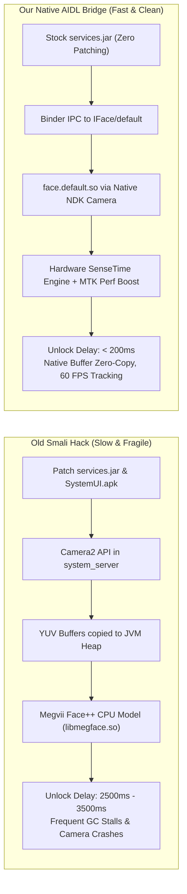
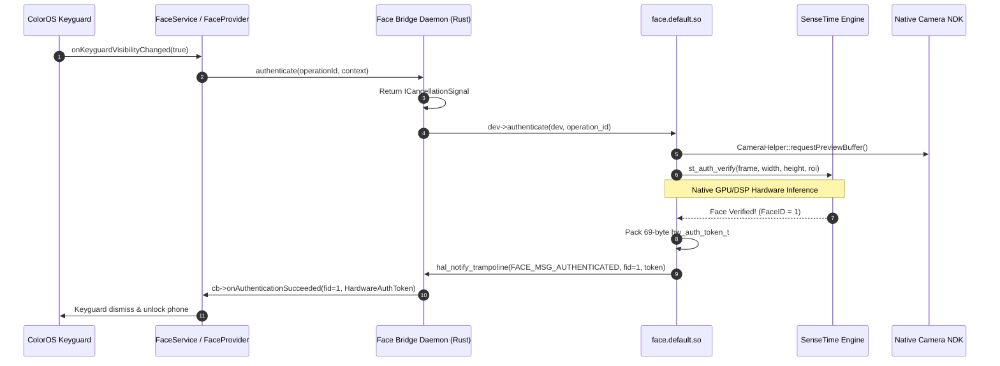

# OPlus Face AIDL HAL Bridge for Transsion Holdings Devices

High-performance, hardware-accelerated, pure-Rust native AIDL Face HAL Bridge (`android.hardware.biometrics.face.IFace/default`) designed for **ColorOS**, **OxygenOS**, and **RealmeUI** ROM ports across all **Transsion Holdings** smartphones (**Tecno**, **Infinix**, and **Itel**), powered by MediaTek (Helio G99 / MT6789, Dimensity series) and UNISOC SoCs.

---

## 1. Executive Summary & Problem Analysis

### The Face Unlock Dilemma on ColorOS Ported ROMs
When porting ColorOS 14/15/16/17 to Transsion devices, Face Unlock is notoriously broken or sluggish:
1. **ServiceManager Hangs**: ColorOS's `FaceProvider` and `FaceService` continuously query `android.hardware.biometrics.face.IFace/default`. When no matching AIDL service is registered in ServiceManager and declared in VINTF, framework initialization blocks or spams:
   ```text
   Waited one second for android.hardware.biometrics.face.virtualhal.IVirtualHal/virtual
   FaceProvider: Daemon was null, skipping init
   ```
2. **The Old Smali/Java Workaround (`ryanistr/OPlusFace.git`)**:
   Previous solutions attempted to bypass the native HAL by injecting Java smali hooks into `services.jar` and `SystemUI.apk`:
   - Opened the front camera via Java `Camera2` / `android.hardware.Camera` directly inside `system_server`.
   - Copied every YUV preview frame across the JVM heap to JNI.
   - Ran an unaccelerated CPU-only Megvii Face++ software model (`libmegface.so`).
   - **Critical Drawbacks**:
     - **Massive Latency**: 2.5 to 3.5 seconds unlock delay due to JVM buffer copies and heavy GC pressure.
     - **Fragility**: Required manual decompilation and smali patching of `services.jar` and `SystemUI.apk` on every ColorOS OTA / ROM update.
     - **Camera Contention**: Holding the camera inside `system_server` caused race conditions and crashes if apps requested the front camera.

### The Native AIDL Bridge Solution
This project eliminates all framework patching by acting as a native drop-in AIDL service (`android.hardware.biometrics.face.IFace/default`):
- **Zero Smali Patching**: `services.jar` and `SystemUI.apk` remain **100% untouched and stock**.
- **Hardware Native Acceleration**: Directly hooks into Transsion's OEM HAL (`/vendor/lib64/hw/face.default.so`), SenseTime neural engine (`libstfaceunlockppl.so`), Native NDK Camera (`libcamera2ndk_vendor.so`), and MediaTek Performance Boost client (`libmtkperf_client_vendor.so`).
- **Sub-200ms Unlock Latency**: Frames are captured by native camera pipelines directly into hardware memory buffers without ever touching the Java heap.
- **Pure Memory-Safe Rust**: Built with `rsbinder` using static dispatch and zero garbage collection overhead.

---

## 2. Architecture & Component Diagrams

### A. High-Level System Architecture

```mermaid
flowchart TD
    subgraph ColorOS_Framework ["ColorOS Framework (Untouched Stock)"]
        KEYGUARD["ColorOS Keyguard / Lockscreen\n(com.android.systemui)"]
        FACESERVICE["FaceService / FaceProvider\n(system_server)"]
        BIOMETRIC_MGR["BiometricPrompt / AuthController"]
    end

    subgraph Android_Binder_IPC ["Android IPC Layer"]
        SM["ServiceManager\n(android.hardware.biometrics.face.IFace/default)"]
        VINTF["VINTF Compatibility Matrix\n(manifest_face_transsion.xml)"]
    end

    subgraph Native_Bridge ["OPlus Face Bridge Daemon (Rust / rsbinder)"]
        IFACE["BnFace Server\n(IFace: getSensorProps, createSession)"]
        ISESSION["BnSession Server\n(ISession: generateChallenge, enroll, authenticate)"]
        ICANCEL["BnCancellationSignal Server\n(cancel)"]
        HAL_WRAPPERS["Transsion HAL FFI Bridge & Callback Dispatcher"]
        BYPASS_ENGINE["SenseTime License & Anti-Tamper Bypass\n(In-Memory GOT Hooking + Symbol Interposition)"]
    end

    subgraph Transsion_Vendor_HAL ["Transsion OEM Hardware Layer"]
        TRAN_HAL["face.default.so\n(/vendor/lib64/hw/face.default.so)"]
        SENSETIME["SenseTime FaceAuth Engine\n(libstfaceunlockppl.so)"]
        NDK_CAM["Native Camera2 NDK\n(libcamera2ndk_vendor.so)"]
        MTK_PERF["MTK Perf Client\n(libmtkperf_client_vendor.so)"]
        DATA_STORE["Hardware Face Storage\n(/data/vendor_de/0/facedata)"]
        CAM_HARDWARE["MIPI-CSI Front Camera Hardware"]
    end

    KEYGUARD --> BIOMETRIC_MGR
    BIOMETRIC_MGR --> FACESERVICE
    FACESERVICE <-->|AServiceManager_waitForService| SM
    SM -.->|Declared In| VINTF

    FACESERVICE <-->|createSession(sensorId, userId, cb)| IFACE
    FACESERVICE <-->|authenticate / enroll| ISESSION
    FACESERVICE <-->|cancel| ICANCEL

    IFACE --> HAL_WRAPPERS
    ISESSION --> HAL_WRAPPERS
    ICANCEL --> HAL_WRAPPERS
    BYPASS_ENGINE -.->|Patches GOT 0xe770| TRAN_HAL
    BYPASS_ENGINE -.->|Sets is_licensed flag| SENSETIME

    HAL_WRAPPERS <-->|face_device_t Function Pointers| TRAN_HAL
    TRAN_HAL <--> SENSETIME
    TRAN_HAL <--> NDK_CAM
    TRAN_HAL <--> MTK_PERF
    TRAN_HAL <--> DATA_STORE
    NDK_CAM <--> CAM_HARDWARE
```

---

### B. Architectural Comparison: Smali Hack vs Native AIDL Bridge



---

### C. Authentication Transaction Flow



---

## 3. Deep Reverse Engineering Analysis

### A. Transsion `face_device_t` Memory Layout
Decompilation and disassembly of `/vendor/lib64/hw/face.default.so` established the exact C struct vtable layout:

| Offset | Field | C Type / Signature | Description |
| :--- | :--- | :--- | :--- |
| `0x00 - 0x77` | `common` | `hw_device_t` | Standard Android hardware device header (`tag=0x48574454`, `close` at `0x70`) |
| `0x80` | `notify` | `face_notify_t` | Callback function pointer |
| `0x88` | `set_notify` | `int (*)(dev, notify_cb)` | Registers callback function trampoline |
| `0x90` | `pre_enroll` | `int (*)(dev, timeout, uint64_t *challenge)` | Generates enrollment challenge nonce |
| `0x98` | `enroll` | `int (*)(dev, hat, timeout, disabled_feats)` | Begins facial scanning & enrollment |
| `0xa0` | `post_enroll` | `int (*)(dev)` | Revokes enrollment challenge |
| `0xa8` | `set_feature` | `int (*)(dev, feat, enabled, hat, face_id)` | Toggles feature flags |
| `0xb0` | `get_feature` | `int (*)(dev, feat, face_id, bool *out)` | Retrieves feature states |
| `0xb8` | `get_authenticator_id` | `int (*)(dev, uint64_t *auth_id)` | Returns Keyguard authenticator ID |
| `0xc0` | `cancel` | `int (*)(dev)` | Cancels ongoing enrollment or authentication |
| `0xc8` | `enumerate` | `int (*)(dev)` | Enumerates enrolled face IDs from storage |
| `0xd0` | `remove` | `int (*)(dev, uint32_t face_id)` | Removes enrolled face record (0 = all) |
| `0xd8` | `set_active_group` | `int (*)(dev, user_id, const char *path)` | Mounts `/data/vendor_de/0/facedata` |
| `0xe0` | `authenticate` | `int (*)(dev, uint64_t op_id)` | Activates front camera & runs verification |
| `0xf0` | `reset_lockout` | `int (*)(dev, hat)` | Clears biometric lockout state |

---

### B. Hardware Auth Token (`hw_auth_token_t`) Wire Packing
In Android biometrics, Keymaster/Gatekeeper authentication requires a 69-byte packed cryptographic token. The Transsion HAL packages this into `msg->extra` upon `FACE_MSG_AUTHENTICATED`:

```rust
#[repr(C, packed)]
#[derive(Clone, Copy, Default, Debug)]
pub struct hw_auth_token_t {
    pub version: u8,               // Offset 0x00 (0x00)
    pub challenge: u64,             // Offset 0x01 (Keyguard challenge)
    pub user_id: u64,               // Offset 0x09 (Android User ID)
    pub authenticator_id: u64,      // Offset 0x11 (Hardware Authenticator ID)
    pub authenticator_type: u32,    // Offset 0x19 (1 = Fingerprint, 2 = Face)
    pub timestamp: u64,             // Offset 0x1d (Monotonic timestamp in ms)
    pub hmac: [u8; 32],             // Offset 0x25 (SHA-256 HMAC from TEE)
}
```
Our bridge automatically unpacks this memory slice into AIDL `HardwareAuthToken` and passes it back to ColorOS framework.

---

### C. SenseTime License & Anti-Tamper Dual Bypass
During initialization, `face.default.so` invokes `face_algorithm_init()`, which calls SenseTime's `st_face_init_license(/vendor/media/license.lic)`:
- On non-stock ROM environments, SenseTime validation fails with error code **`-14`** (`check license is not ok, result code: -14`), causing `face_open` to abort with `-EINVAL` (`-22`).
- Disassembly of `libstfaceunlockppl.so` revealed:
  1. `st_face_init_license` only sets a single internal byte flag: `[libstfaceunlockppl_base + 0x33914e8] = 1`.
  2. The GOT jump slot for `st_face_init_license` in `face.default.so` resides at offset **`0xe770`**.

Our bridge implements a **Dual-Layer Bypass**:
1. **ELF Dynamic Symbol Interposition**:
   The bridge binary is linked with `-Wl,-export-dynamic` and exports `pub extern "C" fn st_face_init_license(...) -> 0`.
2. **Runtime In-Memory GOT Patching**:
   Before calling `methods->open`, the bridge scans `/proc/self/maps`, identifies the memory base of `face.default.so`, adjusts page permissions via `libc::mprotect(PROT_READ | PROT_WRITE)`, and rewrites `GOT[0xe770]` directly to point to our dummy zero-returning handler. It also marks the internal `0x33914e8` license flag in `libstfaceunlockppl.so` as `1`.

---

## 4. AIDL Interface Contract

The daemon satisfies the Android 14 `android.hardware.biometrics.face` AIDL specification (VINTF version 3):

- **Service Descriptor**: `android.hardware.biometrics.face.IFace`
- **Instance Name**: `android.hardware.biometrics.face.IFace/default`
- **Interface Hash**: `fca1ab84dda6c013b251270d848eb6d964a6d765`
- **Interface Version**: `3`
- **Common Interface Hash**: `a9ebb97f5abea1dc6800b69d821ef61944e80e65`
- **Common Interface Version**: `3`

### Sensor Capabilities Declared to ColorOS:
- `sensorId`: `1` (Unique ID; `0` is reserved by Fingerprint HAL)
- `sensorStrength`: `0` (`SensorStrength::CONVENIENCE` / 2D RGB Face Unlock)
- `sensorType`: `0` (`FaceSensorType::RGB`)
- `halControlsPreview`: `true` (Hardware HAL controls preview and camera acquisition natively)
- `maxEnrollmentsPerUser`: `5` (Supports primary + alternate/backup face enrollments)

---

## 5. Output Artifacts

All pre-compiled binaries and packages are generated under the [`out/`](file:///home/rapli/Dokumen/cosfix/OPlus-Face-Bridge-Transsion/out/) directory:

| Filename | Type | Size | Target Location in ROM | SELinux Context |
| :--- | :--- | :--- | :--- | :--- |
| **`android.hardware.biometrics.face-service.default`** | ARM64 ELF | ~962 KB | `/vendor/bin/hw/` *(or `/vendor/odm/bin/hw/`)* | `u:object_r:hal_face_default_exec:s0` |
| **`android.hardware.biometrics.face-service.default.rc`** | Android Init | ~251 B | `/vendor/etc/init/` *(or `/vendor/odm/etc/init/`)* | `u:object_r:vendor_configs_file:s0` |
| **`manifest_face_transsion.xml`** | VINTF Fragment | ~247 B | `/vendor/etc/vintf/manifest/` *(or `/vendor/odm/etc/vintf/manifest/`)* | `u:object_r:vendor_configs_file:s0` |
| **`face_vendor_package.tar.gz`** / **`.zip`** | ROM Repack Bundle | ~485 KB | Contains `vendor/bin/hw/`, `vendor/etc/init/`, and `vendor/etc/vintf/` directory structures | N/A |

---

## 6. ROM Repacking Guide (Vendor & ODM)

> [!IMPORTANT]
> **Root Causes of Prior Enrollment Failures & Solutions**:
> 1. **SELinux Labels in Read-Only EROFS (`config/vendor_file_contexts`)**:
>    - When unpacking and repacking `vendor.img` (EROFS), `mkfs.erofs` relies strictly on `config/vendor_file_contexts` to embed extended attributes (`security.selinux`) into the inodes.
>    - If the newly added files are omitted from `config/vendor_file_contexts`, `mkfs.erofs` defaults their label to `u:object_r:vendor_file:s0`.
>    - Because `init` is blocked by Treble CTS rules (`neverallow init vendor_file:file execute_no_trans`), `init` strictly refuses to execute vendor services labeled `vendor_file:s0` and skips service registration entirely.
>    - Therefore, **you MUST add the entries to `config/vendor_file_contexts`** so that the binary is baked with `u:object_r:hal_face_default_exec:s0` and the `.rc` is baked with `u:object_r:vendor_configs_file:s0`.
> 2. **SenseTime `st_auth_init` & `st_auth_set_roi` Failure (`ret: 3`) When Run via ADB**:
>    - Running the daemon manually via `adb shell` runs under UID 2000 (`shell`).
>    - SenseTime initializes biometric storage in `/data/vendor_de/0/facedata`, which is mode `0700` owned by `system:system` (UID 1000).
>    - When UID 2000 attempts to access `/data/vendor_de/0/facedata`, `access` and `mkdir` fail with `EACCES (Permission Denied)`. SenseTime's `st_auth_init` fails (`ret: -1002`).
>    - When enrollment is triggered, `st_auth_set_roi` fails with `-2` because the SenseTime engine was never initialized, causing `face_enroll` to abort with `ret: 3`.
>    - When started automatically by `init` with proper SELinux labels, the service runs as `user system` (`UID 1000`), allowing `st_auth_init` and `st_auth_set_roi` to succeed cleanly.
> 3. **No `seclabel` in `.rc`**: Avoid `seclabel` in vendor `.rc` files because Android Treble forbids `init` from using `dyntransition`/`setexeccon`, which causes fatal `PLOG(FATAL)` aborts on boot.
> 4. **Sensor ID Collision**: `sensorId` is set to `1` (Fingerprint HAL uses `0`).
> 5. **VINTF Compatibility**: Declared as AIDL Version `3` in `manifest_face_transsion.xml`.
> 6. **Native SenseTime FFI Fix**: Native `enroll` function passes the 5th parameter (`count: usize`), and `pre_enroll` timeout is set to 60 seconds.

### A. Remove Legacy Files & Copy New Artifacts

```bash
# 1. Clean legacy files (if any):
rm -f <unpacked_vendor>/odm/bin/hw/android.hardware.biometrics.face-service.transsion
rm -f <unpacked_vendor>/odm/etc/init/android.hardware.biometrics.face-service.transsion.rc
rm -f <unpacked_vendor>/bin/hw/android.hardware.biometrics.face-service.transsion

# 2. Copy artifacts directly into vendor partitions:
cp out/vendor/bin/hw/android.hardware.biometrics.face-service.default <unpacked_vendor>/bin/hw/
cp out/vendor/etc/init/android.hardware.biometrics.face-service.default.rc <unpacked_vendor>/etc/init/
cp out/vendor/etc/vintf/manifest/manifest_face_transsion.xml <unpacked_vendor>/etc/vintf/manifest/

# (Optional: Also copy to vendor/odm/ for layouts that symlink / mount odm):
mkdir -p <unpacked_vendor>/odm/bin/hw <unpacked_vendor>/odm/etc/init <unpacked_vendor>/odm/etc/vintf/manifest
cp -f out/vendor/bin/hw/android.hardware.biometrics.face-service.default <unpacked_vendor>/odm/bin/hw/
cp -f out/vendor/etc/init/android.hardware.biometrics.face-service.default.rc <unpacked_vendor>/odm/etc/init/
cp -f out/vendor/etc/vintf/manifest/manifest_face_transsion.xml <unpacked_vendor>/odm/etc/vintf/manifest/

# 3. Set file permissions (chmod):
chmod 0755 <unpacked_vendor>/bin/hw/android.hardware.biometrics.face-service.default
chmod 0644 <unpacked_vendor>/etc/init/android.hardware.biometrics.face-service.default.rc
chmod 0644 <unpacked_vendor>/etc/vintf/manifest/manifest_face_transsion.xml
```

---

### B. Filesystem Ownership, UID/GID & fs_config (`config/vendor_fs_config`)

Copy and paste the following lines into your ROM kitchen filesystem configuration file (`config/vendor_fs_config` / `filesystem_config.txt`):

```text
# Face AIDL Bridge Filesystem Configuration (Path UID GID Mode)
vendor/bin/hw/android.hardware.biometrics.face-service.default 0 2000 0755
vendor/etc/init/android.hardware.biometrics.face-service.default.rc 0 0 0644
vendor/etc/vintf/manifest/manifest_face_transsion.xml 0 0 0644
vendor/odm/bin/hw/android.hardware.biometrics.face-service.default 0 2000 0755
vendor/odm/etc/init/android.hardware.biometrics.face-service.default.rc 0 0 0644
vendor/odm/etc/vintf/manifest/manifest_face_transsion.xml 0 0 0644
```

#### UID / GID Reference Table
| File Path | UID | GID | User / Group | Permissions | Mode |
| :--- | :--- | :--- | :--- | :--- | :--- |
| `vendor/bin/hw/android.hardware.biometrics.face-service.default` | `0` | `2000` | `root` : `shell` *(or `root:root`)* | `rwxr-xr-x` | `0755` |
| `vendor/etc/init/android.hardware.biometrics.face-service.default.rc` | `0` | `0` | `root` : `root` | `rw-r--r--` | `0644` |
| `vendor/etc/vintf/manifest/manifest_face_transsion.xml` | `0` | `0` | `root` : `root` | `rw-r--r--` | `0644` |
| `vendor/odm/bin/hw/android.hardware.biometrics.face-service.default` | `0` | `2000` | `root` : `shell` *(or `root:root`)* | `rwxr-xr-x` | `0755` |
| `vendor/odm/etc/init/android.hardware.biometrics.face-service.default.rc` | `0` | `0` | `root` : `root` | `rw-r--r--` | `0644` |
| `vendor/odm/etc/vintf/manifest/manifest_face_transsion.xml` | `0` | `0` | `root` : `root` | `rw-r--r--` | `0644` |

---

### C. SELinux File Contexts (`config/vendor_file_contexts`)

> [!IMPORTANT]
> **Crucial for EROFS Repacking**:
> In EROFS filesystems, SELinux labels are read-only and embedded at build time by `mkfs.erofs`. Add these lines to your kitchen's `config/vendor_file_contexts` (and `<unpacked_vendor>/etc/selinux/vendor_file_contexts`):

```text
# Primary Vendor Paths (Native AOSP / ColorOS):
/(vendor|system/vendor)/bin/hw/android\.hardware\.biometrics\.face-service\.default         u:object_r:hal_face_default_exec:s0
/(vendor|system/vendor)/etc/init/android\.hardware\.biometrics\.face-service\.default\.rc   u:object_r:vendor_configs_file:s0
/(vendor|system/vendor)/etc/vintf/manifest/manifest_face_transsion\.xml                    u:object_r:vendor_configs_file:s0

# Secondary Vendor ODM Paths (if keeping ODM layout):
/(vendor/)?odm/bin/hw/android\.hardware\.biometrics\.face-service\.default                 u:object_r:hal_face_default_exec:s0
/(vendor/)?odm/etc/init/android\.hardware\.biometrics\.face-service\.default\.rc           u:object_r:vendor_configs_file:s0
/(vendor/)?odm/etc/vintf/manifest/manifest_face_transsion\.xml                            u:object_r:vendor_configs_file:s0
```

#### 2. Service Contexts (`plat_service_contexts`)
The ServiceManager AIDL service is registered in the Android framework:
```text
android.hardware.biometrics.face.IFace/default  u:object_r:hal_face_service:s0
```
*(This rule is already present out-of-the-box in Android 14 / ColorOS).*

#### 3. Sepolicy CIL Rules (`vendor_sepolicy.cil` / `odm_sepolicy.cil`)
The `hal_face_default` domain inherits the `hal_face_server` attribute in AOSP. If your ROM enforces strict SELinux rules, ensure the following CIL rules exist in `<unpacked_vendor>/etc/selinux/vendor_sepolicy.cil` (or append them to your vendor custom CIL file):

```cil
;; 1. Process transition from init to hal_face_default upon executing binary
(allow init hal_face_default (process (transition siginh rlimitinh)))
(dontaudit init hal_face_default (process (noatsecure)))
(allow hal_face_default hal_face_default_exec (file (read getattr map execute open entrypoint)))
(typetransition init hal_face_default_exec process hal_face_default)

;; 2. ServiceManager permissions & Binder IPC to system_server
(allow hal_face_default hal_face_service (service_manager (add find)))
(allow hal_face_default servicemanager (binder (call transfer)))
(allow servicemanager hal_face_default (binder (call transfer)))
(allow servicemanager hal_face_default (dir (search)))
(allow servicemanager hal_face_default (file (read open)))
(allow servicemanager hal_face_default (process (getattr)))
(allow system_server hal_face_default (binder (call transfer)))
(allow hal_face_default system_server (binder (call transfer)))

;; 3. Access to facial biometric database (/data/vendor_de/[0-9]+/facedata)
(allow hal_face_default face_vendor_data_file (dir (ioctl read write getattr lock open watch watch_reads add_name remove_name search)))
(allow hal_face_default face_vendor_data_file (file (ioctl read write create getattr setattr lock append map unlink rename open watch watch_reads)))

;; 4. Access to SenseTime libraries & Camera NDK
(allow hal_face_default vendor_file (file (read getattr map execute open)))
(allow hal_face_default same_process_hal_file (file (read getattr map execute open)))
(allow hal_face_default hal_camera_default (binder (call transfer)))
(allow hal_face_default ion_device (chr_file (read open ioctl)))
(allow hal_face_default property_socket (sock_file (write)))
(allow hal_face_default init (unix_stream_socket (connectto)))
```

---

## 7. Verification & Diagnostic Commands

After booting into ColorOS:

1. **Verify Service Registration in ServiceManager**:
   ```bash
   adb shell service check android.hardware.biometrics.face.IFace/default
   ```
   *Expected Output:*
   ```text
   Service android.hardware.biometrics.face.IFace/default: found
   ```

2. **Verify Daemon Execution and SELinux Domain**:
   ```bash
   adb shell ps -AZ | grep face-service
   ```
   *Expected Output:*
   ```text
   u:r:hal_face_default:s0  system  <PID>  .../bin/hw/android.hardware.biometrics.face-service.default
   ```

3. **Check Biometrics Sensor Registry**:
   ```bash
   adb shell dumpsys biometric
   ```
   *Expected Output (both Fingerprint and Face registered without collision):*
   ```text
   Sensors:
    ID(0), ... modality 2  <-- Fingerprint
    ID(1), ... modality 4  <-- Face Unlock
   ```

4. **Check Real-Time Logcat Telemetry**:
   ```bash
   adb logcat -s face_transsion FaceProvider FaceService
   ```

---

## 8. Building from Source

### Prerequisites
- Linux machine (Ubuntu / Debian / Arch / Fedora).
- Rust toolchain (`rustup target add aarch64-linux-android`).
- Android NDK **r26b** installed at `/home/rapli/android-ndk-r26b` (or set `$ANDROID_NDK_HOME`).

### Build Steps
```bash
git clone https://github.com/RapliVx/OPlus-Face-Bridge-Transsion.git
cd OPlus-Face-Bridge-Transsion
chmod +x build.sh
./build.sh release
```
Outputs will be generated cleanly in the `out/` folder.
